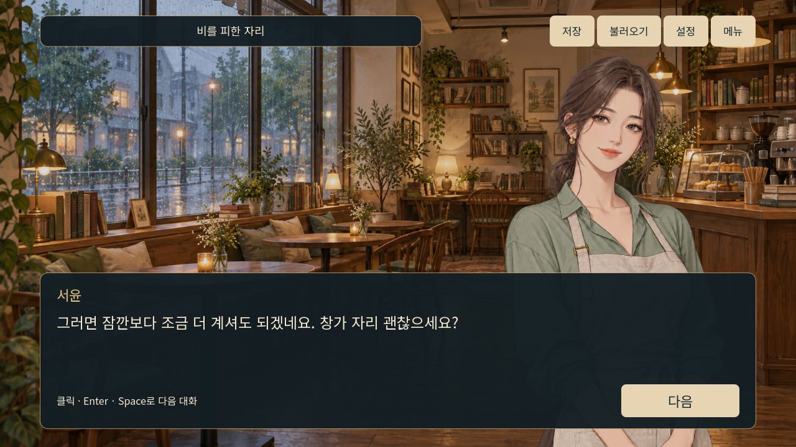

# 비가 그치면, 한 잔 더

Godot로 만든 한국어 2D 연애 비주얼 노벨입니다. 세 번의 첫 만남과 다섯 날의 새 일상, 총 다섯 엔딩을 담았습니다.

현재 버전은 **35단계까지 완료한 v0.2.0**입니다. 월~금 5일과 하루 두 행동, 조건부 이야기 4편, 민재와 세 주간 엔딩을 담았습니다. **새로운 한 주 시작**을 누르세요. 기존 두 엔딩은 **첫 만남 읽기 · 기존 이야기**에 보존했습니다. [35단계 실행·엔딩 안내](lessons/lesson35_261022.md)에서 조건과 저장 호환성을 확인할 수 있습니다.

현재 PC에서는 `builds/Windows_v0.2.0_261022/AfterTheRain_261022.exe`로 실행하고, 전달할 때는 `builds/AfterTheRain_Windows_v0.2.0_261022.zip` 전체를 사용하세요. Godot 설치가 필요하지 않습니다. v0.2.0은 로컬 제작·검증을 마쳤으며 원격 릴리스는 아직 게시하지 않았습니다.

**[기존 v0.1.0 공개 배포본](https://github.com/yts19850201/After_The_Rain_Romance/releases/tag/v0.1.0)** · **[자세한 실행·학습 안내](README_261022.md)**

ZIP을 모두 풀고 `AfterTheRain_261022.exe`를 실행하세요. 같은 폴더의 pck가 필요하며 Godot 설치는 필요하지 않습니다. 소스를 내려받아 편집하려면 Godot 4.7.2 Standard를 사용합니다.

저장 슬롯 3개, 엔딩 감상, 글자 속도·음량 설정을 지원합니다. 인물은 성인이고 이 버전에는 노출·성적 장면이 없습니다. 그림과 대본 등은 AI 도움으로 제작했으며 실행 중 AI 서비스나 인터넷 연결은 사용하지 않습니다.

v0.1.0은 첫 시험 배포입니다. 사람의 실제 읽기 시간과 외부 피드백은 아직 수집하지 않았습니다. [피드백 남기기](https://github.com/yts19850201/After_The_Rain_Romance/issues/new/choose).

[자산 출처와 이용 조건](assets/ASSET_SOURCES_261022.md) · [엔진·구성 요소 고지](distribution/licenses) · [배포 검토](distribution/platform_review_261022.md)

2026-10-22 · 35단계까지 구현·검사한 학습 프로젝트. Steam·itch.io 등록이나 유료 판매를 완료한 상태는 아닙니다. 공개 소스에 별도의 프로젝트 전체 오픈소스 라이선스를 부여한 것은 아니며, 엔진과 글꼴의 이용 조건은 각각의 고지를 따릅니다.
